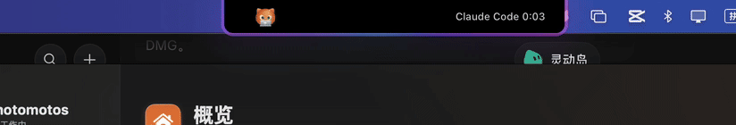
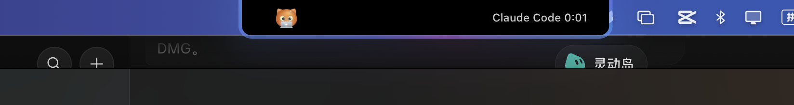
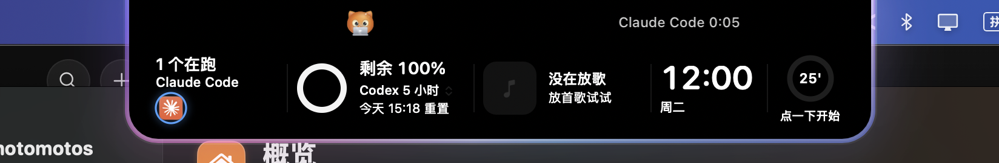
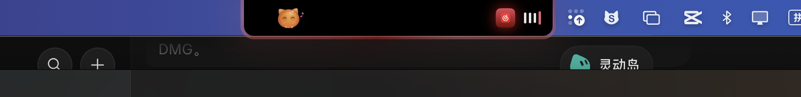
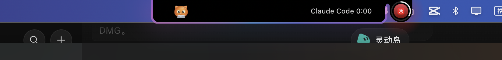
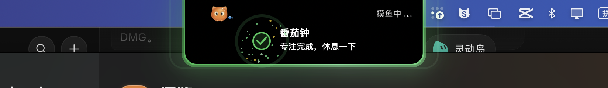

# motomotos — Dynamic Island for your Mac notch

**motomotos** turns the MacBook notch into a live **Dynamic Island for macOS**, built for people who code with AI agents. It watches **Claude Code, Codex, Grok, DeepSeek Harness, Hermes and WorkBuddy**, shows what is left of each agent's quota, tells you when a task finishes, fails or waits for your approval, and keeps music, a pomodoro timer and your apps one hover away — with a cat that lives in the notch.

**motomotos 是一个 Mac 刘海屏灵动岛（Dynamic Island）应用**：把 MacBook 的刘海变成会动的灵动岛，专为用 AI 写代码的人做——跟着 Claude Code、Codex、Grok、DeepSeek 干活，显示每个 AI 的剩余额度，任务做完、出错、等你批准时在刘海上提醒；还有音乐、番茄钟、常用软件和一只住在刘海里的小猫。

Website / 官网: https://motomotos.com · Support: support@motomotos.com



This repository hosts installers and release notes only. The app's source code is not public.

## What it does

| | |
|---|---|
|  | **AI agent status in the notch.** While Claude Code, Codex or another agent works, the island's rim glows and the right ear shows which agent and for how long. Done, error and approval requests pop out of the notch. |
|  | **Hover band.** Rest the pointer on the notch: running sessions, remaining AI quota, now playing, clock and weather, and the pomodoro slide in. Click to open the full panel. |
|  | **Now playing.** Cover art and a live equalizer in the notch (Apple Music, Spotify, NetEase Cloud Music and more). |
|  | **Two things at once.** An agent running while a song plays: the island pinches off a small drop that holds the music. |
|  | **Pomodoro and reminders.** Set a focus length on the card; when time is up the notch tells you. |

Also: AI quota for every agent with the exact reset day and time, terminal and session list with each agent's own icon, approvals from the notch, token usage, battery, calendar, weather, launcher, notes, to-dos, stickies, WeChat / Telegram / WhatsApp unread badges, volume and brightness HUD.

## Install

Download **Motomotos.dmg** from [Releases](https://github.com/ygalex0927-eng/motomotos-releases/releases/latest) or https://motomotos.com, open it and drag **Motomotos** into Applications. The app is signed with a Developer ID and notarized by Apple.

Or in Terminal:

```bash
curl -fsSL https://raw.githubusercontent.com/ygalex0927-eng/motomotos-releases/main/install.sh | bash
```

Requirements: Apple silicon Mac, **macOS 15** or later. Best on a notched MacBook (Air / Pro); with the lid closed on an external display, or on a Mac without a notch, the island sits at the top middle of the menu bar.

After updating from an older version, turn **Screen Recording** and **Automation** back on for motomotos in System Settings › Privacy & Security.

## Pricing

Free trial with every feature, then a one-time purchase. Buy in the app's Account window or at https://motomotos.com.

## 安装（中文）

从 [Releases](https://github.com/ygalex0927-eng/motomotos-releases/releases/latest) 或官网下载 **Motomotos.dmg**，打开后把 Motomotos 拖进「应用程序」即可（已通过 Apple 公证）。也可以在「终端」里粘贴上面那行命令。需要 Apple 芯片的 Mac、macOS 15 以上；刘海屏 MacBook 效果最好，外接显示器或没有刘海的 Mac 上，灵动岛显示在菜单栏正中。

---

Keywords: Dynamic Island for Mac, macOS Dynamic Island, MacBook notch app, notch utility, menu bar app, AI coding agent monitor, Claude Code quota / usage limit, Codex usage, Grok, DeepSeek, now playing in notch, pomodoro timer, 灵动岛, Mac 灵动岛, 刘海屏, MacBook 刘海, AI 编程助手, Claude Code 额度.
